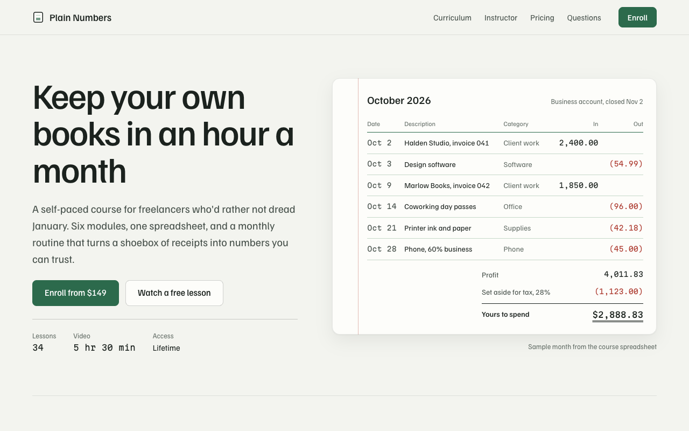

# Plain Numbers: Astro online course website template

A sales page for an online course: who it's for, outcomes, the curriculum by module with lesson lengths, the instructor, student outcomes (sample), pricing tiers with checkout links, a refund line, FAQ, a free sample lesson page and a questions form. Static, fast, and no server needed.



[](https://console.cloudzyro.com/new?repo=https://github.com/Cloudzyro/template-online-course)

## What's included

- Long sales page: hero with a sample ledger drawn in code, who it's for and not for, outcomes, curriculum, instructor, student results and quotes (clearly marked sample), pricing, FAQ and a final call to action with a questions form
- Curriculum by module as open-and-close lists with each lesson's length; lesson count and total video time are worked out from the lessons, so they're never out of date
- A full curriculum page with every lesson, and a free sample lesson page with a video placeholder, steps and a transcript
- Three pricing tiers, each linking to its own checkout (Stripe Payment Links, Lemon Squeezy, Paddle, Gumroad or any hosted checkout). A tier without a link asks by email instead, so nothing breaks before you connect payments
- Course structured data (schema.org) with offers, Open Graph tags, sitemap, robots.txt, favicon and a 404 page
- Responsive down to 360px, keyboard friendly, reduced motion respected

## Run it locally

```bash
pnpm install
pnpm dev        # http://localhost:4321
pnpm build      # static site in dist/
pnpm preview
```

## Make it yours

- **Content:** everything is in `src/data/site.ts`: the course name and headline, who it's for, outcomes, modules and lessons (title and minutes; mark one `free: true`), the instructor, sample results and quotes, pricing tiers, FAQ, the free lesson and the ledger in the hero. Results and quotes are samples; replace them with your own students'.
- **Checkout links:** set `PUBLIC_CHECKOUT_URL_SELF_PACED`, `PUBLIC_CHECKOUT_URL_WORKBOOK` and `PUBLIC_CHECKOUT_URL_WITH_REVIEWS` to each tier's checkout page, or put the links in each tier's `checkout` in `src/data/site.ts`. Rename or add tiers there too (each tier names the env var it reads in `env`). Without a link, that tier's button opens an email to ask about it.
- **Questions form:** set `PUBLIC_FORM_ENDPOINT` to a form endpoint from Formspree, Basin, a Supabase function or similar. The form sends `name`, `email`, `question` and `waitlist` as form data. With no endpoint set, the form shows a short note and opens the visitor's email app addressed to the email in `src/data/site.ts`.
- **Sample lesson video:** replace the placeholder in `src/pages/lessons/sample.astro` with your course platform's embed or a `<video>` element.
- **Site address:** set `SITE_URL` (for example `https://www.plainnumbers.com`) so the sitemap, canonical links and social previews use your domain.
- **Colors and fonts:** colors are CSS variables at the top of `src/styles/global.css`. Fonts are Familjen Grotesk and Martian Mono (figures, lesson numbers and lengths), self-hosted with Fontsource and imported in `src/layouts/Base.astro`.
- **Social preview image:** replace `public/og.png` (1200 x 630).

Environment variables are read at build time. Locally, put them in `.env` (see `.env.example`):

```bash
PUBLIC_CHECKOUT_URL_SELF_PACED=https://buy.stripe.com/your-link
PUBLIC_CHECKOUT_URL_WORKBOOK=https://buy.stripe.com/your-link
PUBLIC_CHECKOUT_URL_WITH_REVIEWS=https://buy.stripe.com/your-link
PUBLIC_FORM_ENDPOINT=https://formspree.io/f/your-id
SITE_URL=https://www.plainnumbers.com
```

## Deploy

Click the Deploy button above, or push your own copy to GitHub and connect it in the Cloudzyro console. Add the environment variables in your site's settings. The build command is `pnpm build` and the output folder is `dist/`, a plain static site.

## Stack

- Astro 7 (static output)
- @astrojs/sitemap
- Fontsource (Familjen Grotesk, Martian Mono)
- TypeScript, plain CSS

MIT licensed. See [LICENSE](./LICENSE).
